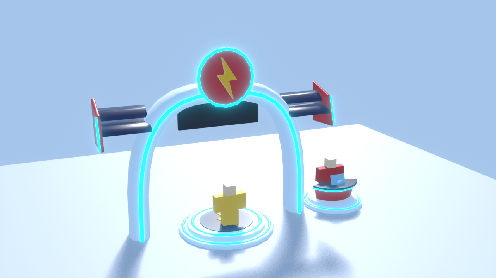
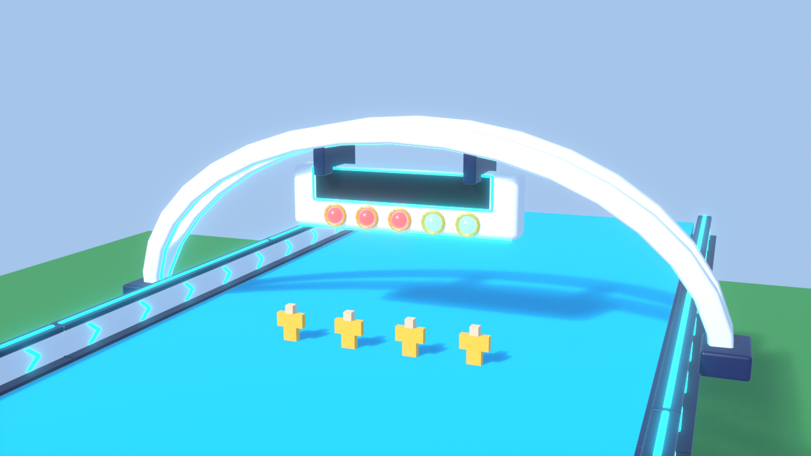
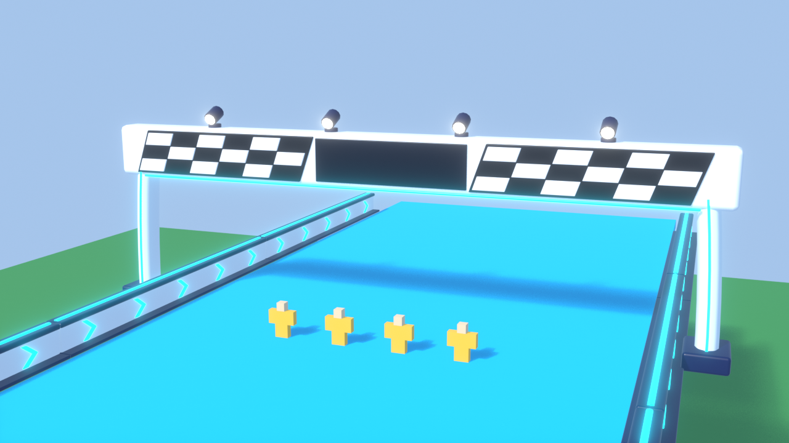
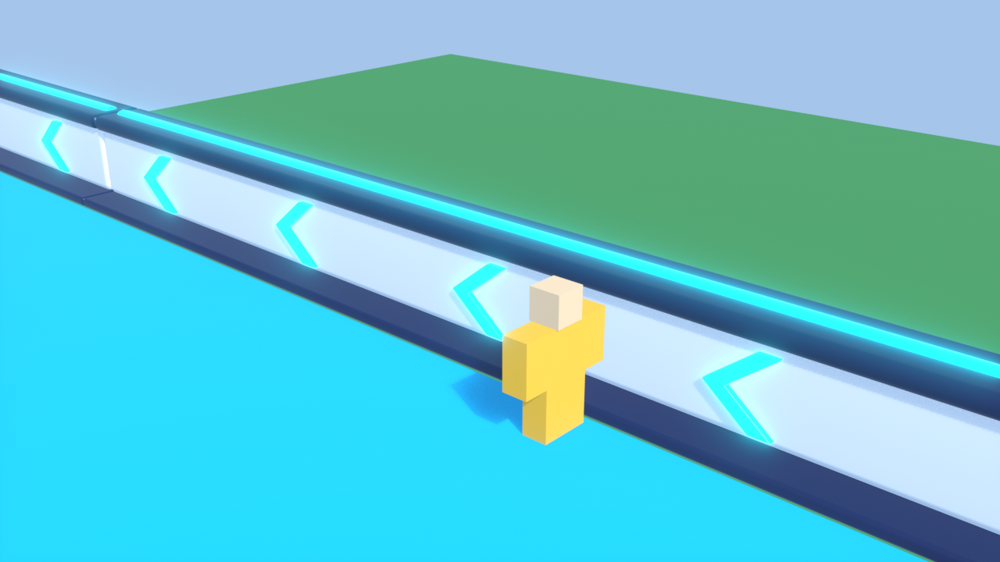

# Arte de la carrera: importar los modelos 3D en Roblox Studio

Fecha: 2026-09-25. Generado por `audit/generate_race_assets.py`, un script de Blender.

Desde código no se pueden subir mallas a Roblox porque no hay clave de Open Cloud. Por eso hace falta **una sola importación manual en Studio**. Son unos 5 minutos. Después, el build mete los modelos en los 3 worlds y el juego los coloca solo.

Mientras no hagas esto, la carrera sigue funcionando con las piezas de bloques de siempre. Nada se rompe.

## Qué hay en esta carpeta

| Archivo | Qué es |
|---|---|
| `fbx/RaceLobbyBooth.fbx` | Entrada del lobby. Tiene un podio con escalones (es el pad para unirse), un portal aerodinámico con alerones tipo F1, el emblema del rayo en 3D, el panel "RACE" y el mostrador curvo donde está The Flash. |
| `fbx/RaceStartGantry.fbx` | Arco doble de salida sobre la pista de 72 studs. Lleva un panel central para el temporizador o el nombre del evento, y 5 luces esféricas (rojo → verde) en anillos dorados. |
| `fbx/RaceFinishGantry.fbx` | Arco de meta. Tiene paneles a cuadros en diagonal, el panel "FINISH", 4 focos arriba y 4 puntos de confeti. |
| `fbx/RaceTrackBarrier.fbx` | Módulo de valla de 56 studs con chevrons neón en relieve. Se repite 39 veces por lado. |
| `preview/*.png` | Render de cada modelo, para verlos antes de importar. |
| `race_assets.blend` | La escena de Blender, por si quieres retocar algo. |
| `race_assets_manifest.json` | Lista de cada pieza: rol, centro, tamaño y triángulos. |

Vistas previas:

## Pasos en Studio

Hazlo en un place vacío, no en los places del juego. Así no tocas nada del juego.

1. **Abre un place nuevo.** En Studio: `File > New` (o la plantilla **Baseplate**). Tienes que haber iniciado sesión con la cuenta dueña del juego. Si el juego es de un grupo, abre un place de ese grupo para que las mallas se suban a su nombre.

2. **Importa cada FBX, uno por uno.** Pestaña `Home` (o `Model`) > **Import 3D**, o bien `File > Import 3D`. Elige `design/race/fbx/RaceLobbyBooth.fbx`. En la ventana de vista previa del importador:
   - **Scale Unit / Unidad de escala: `Stud`**, si aparece la opción. Si no la cambias tampoco pasa nada, porque el juego corrige el tamaño de cada pieza.
   - **Merge Meshes / Fusionar mallas: DESMARCADO**. Cada color tiene que ser su propia MeshPart.
   - Lo demás, como viene: *Import Only As Model* marcado, ejes por defecto (Y arriba, -Z adelante).
   - Pulsa **Import**. Aparece en Workspace un Model llamado `RaceLobbyBooth` con sus MeshParts.

   Repite con `RaceStartGantry.fbx`, `RaceFinishGantry.fbx` y `RaceTrackBarrier.fbx`.

3. **Comprueba los nombres.** No cambies ningún nombre: el juego busca cada pieza por su nombre exacto. Deben salir 27 MeshParts:
   - `RaceLobbyBooth`: 7 MeshParts.
   - `RaceStartGantry`: 10 MeshParts, incluidas `RaceStartGantry__Light_1` a `RaceStartGantry__Light_5`.
   - `RaceFinishGantry`: 7 MeshParts.
   - `RaceTrackBarrier`: 3 MeshParts.

   Los colores que veas en Studio dan igual: el juego pinta cada pieza según la tabla de abajo.

4. **Agrúpalas.** En Workspace crea una **Folder** (clic derecho en Workspace > `Insert Object > Folder`) y llámala exactamente **`RaceAssets`**. Arrastra dentro los 4 modelos.

   Es opcional: si quieres, selecciona todas las MeshParts y pon `CollisionFidelity = Box`. Ahorra memoria, porque el juego nunca las usa para colisionar; los colliders son piezas invisibles aparte.

5. **Guárdala en archivo.** Clic derecho en la carpeta `RaceAssets` > **Save to File...** (Guardar en archivo). Guárdala como:

   `C:\Users\Aoshy´\Desktop\Update2\design\race\RaceAssets.rbxm`

   Luego cierra ese place sin guardar. Si lo haces dentro de un place del juego, borra la carpeta antes de guardarlo.

6. **Build.** Dile a Claude "ya está RaceAssets.rbxm", o ejecútalo tú desde la carpeta del proyecto:
   - `lune run audit/build_update4.luau list` tiene que decir: `race art: design/race/RaceAssets.rbxm -> ServerStorage.RaceAssets; meshes for RaceLobbyBooth, RaceStartGantry, RaceFinishGantry, RaceTrackBarrier`.
   - Si algún modelo sale como `part geometry kept: ...`, la línea dice la pieza que falta o que tiene mala forma. Normalmente es un nombre cambiado o *Merge Meshes* marcado.
   - Después, el build normal (`lune run audit/build_update4.luau --allow-locks`). Mete `ServerStorage.RaceAssets` en los 3 places y construye la pista y la entrada con las mallas.

Si más adelante se regeneran los modelos (otro diseño en Blender), repite los pasos 2 a 6 y sobrescribe el `.rbxm`.

## Qué hace el juego con los modelos

- **`RaceArenaBuilder`** (`src/common/ServerScriptService/Services/Race/RaceArenaBuilder.luau`) clona cada MeshPart, le pone el tamaño y la posición exactos de la tabla `AssetSpec` y la pinta según su rol. La tabla `AssetSpec` la escribe el script de Blender.
  - Todas las mallas quedan ancladas, sin sombra, sin colisión, sin toque y sin consultas.
  - Cada modelo se comprueba por separado. Si a uno le falta una pieza o tiene la forma mal, solo ese modelo vuelve a los bloques de antes. El log dice por qué.
- **Salida (`RaceStartGantry`):** va en `Workspace.RaceArena.Structure.StartGantry`. Las esferas pasan a llamarse `Light1` a `Light5`, que es lo que colorea el cliente en la cuenta atrás. El panel lleva un `SurfaceGui` llamado `PanelGui` con dos textos, `Title` y `Status`. La barra STOP y la puerta invisible no cambian.
- **Carteles de 500, 1000 y 1500 studs y "LAST 200!":** usan el mismo arco sin luces, con el texto en el panel.
- **Meta (`RaceFinishGantry`):** lleva el texto "FINISH". Tiene 4 `Attachment` llamados `ConfettiSpot_1` a `ConfettiSpot_4`, cada uno con un `ParticleEmitter` "Confetti" apagado (`Rate = 0`). Cualquier script puede lanzar confeti con `:Emit(n)`.
- **Vallas (`RaceTrackBarrier`):** van 39 módulos por lado, de la pared de salida a la pared final, en x ±38.7. Su cara interior coincide con los muros invisibles, que siguen igual y son los que de verdad frenan al jugador. Sustituyen los bordillos.
- **Entrada (`RaceLobbyBooth`):** va en `Workspace.RaceGate`.
  - `RaceGatePad` sigue en el mismo sitio, con el mismo tamaño (12×12) y el mismo trigger, pero ahora es invisible: el podio hace de pad.
  - `RaceGateSign` flota sobre el emblema.
  - Los colliders son piezas invisibles `Collider_*`: el podio, el kiosko, los pilares y el mostrador.
  - **`RaceGate.FlashSpot`** es una pieza invisible de 2 × 0.2 × 2. Su cara de abajo es el suelo del kiosko donde van los pies de The Flash, y mira hacia los jugadores. Es lo que lee `LobbyNpcs`. Solo existe con la cabina: sin mallas, The Flash usa su sitio de siempre junto a la puerta.
- **Tamaño:** mide unos 35.7 × 22.7 × 12.0 studs (x × y × z) desde el centro del pad. El kiosko de The Flash queda a la derecha del jugador que llega. Cabe en los 3 lobbies, comprobado con `audit/test_u4_race_placement.luau`.

## Tabla de roles: nombre → color y material de Roblox

Cada objeto se llama `<Modelo>__<Rol>`, por ejemplo `RaceFinishGantry__Checker_White`. Las luces de salida son `RaceStartGantry__Light_1` a `RaceStartGantry__Light_5`, todas con el rol `Light`. El juego aplica esta tabla, que es `RaceArenaBuilder.AssetRoles`:

| Rol | Color (RGB) | Material | Notas |
|---|---|---|---|
| `Base` | 238, 243, 250 | SmoothPlastic | Cuerpo blanco perla: arcos, podio, cuerpo de la valla. |
| `Trim` | 24, 38, 86 | SmoothPlastic | Azul marino: bases, remates, alerones, focos. |
| `Accent` | 0, 229, 255 | Neon | Líneas y chevrons cian. |
| `Gold` | 255, 193, 37 | SmoothPlastic (Reflectance 0.15) | Rayos y anillos de las luces. |
| `Red` | 220, 34, 44 | SmoothPlastic | Rojo Flash: disco del emblema, placas de los alerones, mostrador. |
| `Glass` | 130, 225, 255 | Glass (Transparency 0.45) | Pantalla holográfica del mostrador. |
| `Panel` | 14, 20, 38 | SmoothPlastic | Paneles oscuros con texto (`SurfaceGui`). |
| `Light` | 60, 18, 18 | Neon | Luces de salida apagadas; el cliente las pone rojas y luego verdes. |
| `Lamp` | 255, 246, 214 | Neon | Lentes de los focos de la meta. |
| `Checker_White` | 248, 248, 250 | SmoothPlastic | Cuadros blancos de la meta. |
| `Checker_Black` | 22, 22, 28 | SmoothPlastic | Fondo negro de los cuadros. |

Objetos de cada modelo:

- **`RaceLobbyBooth`:** `Accent`, `Base`, `Glass`, `Gold`, `Panel`, `Red`, `Trim`.
- **`RaceStartGantry`:** `Accent`, `Base`, `Gold`, `Light_1` … `Light_5`, `Panel`, `Trim`.
- **`RaceFinishGantry`:** `Accent`, `Base`, `Checker_Black`, `Checker_White`, `Lamp`, `Panel`, `Trim`.
- **`RaceTrackBarrier`:** `Accent`, `Base`, `Trim`.

## Datos técnicos

- **Unidades:** 1 unidad de Blender = 1 stud. El FBX se exporta con *Apply Scalings: FBX Units Scale*, adelante −Z, arriba Y y *Apply Transform*. Cada objeto tiene su origen en el centro de su caja. El script reimporta cada FBX en Blender y comprueba que los tamaños vuelven iguales.
- **Estilo "juguete Roblox":** Bevel con límite de ángulo 35°, 2 segmentos y perfil normal (sin perfil custom), más WeightedNormal. Las caras que nunca se ven, porque van pegadas a otra superficie, no se modelan.
- **Triángulos:** unos 11.400 en total (presupuesto 8.000–12.000; la valla cuenta una vez). Las cifras exactas por modelo están en `race_assets_manifest.json`.
- **Piezas en la pista con mallas:** 512, por debajo del límite de 600. Las vallas van en los chunks *Atomic* de la decoración, así que en móvil solo se cargan las cercanas.
- **Regenerar:** `"C:\Program Files\Blender Foundation\Blender 4.5\blender.exe" -b --factory-startup --python audit/generate_race_assets.py`. Reescribe los FBX, los PNG, el `.blend`, el manifest y el bloque `AssetSpec` de `RaceArenaBuilder.luau`. Después hay que volver a importar en Studio.
- **Tests:** `lune run audit/test_u4_race_assets.luau`, `audit/test_u4_race_arena.luau` y `audit/test_u4_race_placement.luau`.
